# Design Document 90: `tide_hmppi_soc_top.sv` — Monolithic TIDE + H-MPPI Integrated System-on-Chip

**Spec Reference:** §8.1, Monolithic Cyber-Physical Avionics Integration  
**Target:** Arizona State University ASAP7 7 nm FinFET and Xilinx Artix-7 FPGA  
**Gate Count:** 531,661 standard cells (ASAP7 synthesis)  
**FPGA Resources:** 23,242 LUTs, 87 DSPs (Artix-7 XC7A100T)  

---

## 1. Architectural Philosophy: Closing the Cyber-Physical Loop

In traditional avionics architectures, state estimation (EKF) and optimal trajectory planning (MPPI) are decoupled into separate computing modules communicating over shared SPI, CAN, or Ethernet buses. This off-chip separation introduces:

1. **Bus latency and jitter**: Serializing 16-state covariance matrices and trajectory arrays introduces 2–5 ms of transmission delay, which can exceed an entire control period at 400 Hz.
2. **Clock domain drift**: Asynchronous sensor sampling creates phase lag between the estimator's belief state and the controller's planning origin, degrading closed-loop tracking accuracy.
3. **Power inefficiency**: Driving high-capacitance external PCB traces at high data rates consumes hundreds of milliwatts in I/O buffer switching alone.

`tide_hmppi_soc_top.sv` eliminates this architectural bottleneck by uniting the **96-bit 5-slot VLIW TIDE EKF coprocessor** and the **4-lane H-MPPI trajectory optimization engine** onto a single monolithic die. The state estimator and path planner share a tightly coupled **zero-wait-state dual-ported TIDE-RAM**, allowing the optimal controller to execute directly on freshly updated state estimates within **44.94 µs** of sensor packet arrival.

---

## 2. SoC Micro-Architecture

```mermaid
graph TD
    subgraph SOC ["Monolithic TIDE + H-MPPI System-on-Chip"]
        subgraph TIDE_Core ["TIDE 96-Bit VLIW EKF Coprocessor"]
            VLIW["5-Slot VLIW Sequencer<br/>492-Word Microcode RAM"]
            MUL_ADD["FP32 Multiplier and Adder Lanes"]
            DIV_SQRT["Radix-2 Non-Restoring Div/Sqrt Lane"]
            OOSM["Temporal Journal and Rollback FSM"]
        end

        subgraph SharedMem ["Dual-Ported Coherent TIDE-RAM (4 KB)"]
            STATE_MEM["Estimated State Vector<br/>x, y, z, vx, vy, vz, q0-q3, slosh"]
            COV_MEM["16x16 Covariance Matrix P"]
        end

        subgraph HMPPI_Core ["Hardware-Accelerated MPPI Engine"]
            SOBOL["4D Sobol QMC Generator"]
            LANES["4 Folded Rollout Lanes<br/>Attitude + Chebyshev Slosh + Barriers"]
            RED["Parallel Reduction and Min-Cost Tracker"]
            FEXP2["Base-2 Softmax Exponent Normalizer"]
        end

        subgraph Avionics_Bridge ["Flight Controller Interface"]
            AXI["AXI4-Lite Slave Controller"]
            MAV["MAVLink v2 Actuator Command Mixer"]
            WDG["50 ms Failsafe Hardware Watchdog"]
        end

        TIDE_Core <--> SharedMem
        SharedMem --> HMPPI_Core
        AXI --> TIDE_Core
        AXI --> HMPPI_Core
        HMPPI_Core --> MAV
        WDG --> MAV
    end
```



---

## 3. End-to-End Execution Timeline

The monolithic SoC achieves a complete sense-estimate-plan-actuate cycle in under 45 µs:

```
Time (µs)   Event                                                      Cycles (50 MHz)
────────────────────────────────────────────────────────────────────────────────────────
  0.00      Sensor packet received over AXI4-Lite bus                  0
  0.08      TIDE OOSM temporal journal checks measurement timestamp    4
  0.40      TIDE VLIW coprocessor begins microcode execution           20
 20.20      TIDE completes 492 microcode instructions                  1,010
            State vector updated in shared TIDE-RAM
 20.24      Zero-latency internal strobe triggers H-MPPI engine        1,012
 44.60      H-MPPI completes 128 rollout evaluations                   2,230
 44.94      Optimal actuator commands latched into MAVLink mixer        2,247
────────────────────────────────────────────────────────────────────────────────────────
Total: 44.94 µs end-to-end (enabling > 22,000 Hz full-state closed-loop control)
```

### Latency Budget Breakdown

| Phase | Module | Cycles | Duration (50 MHz) |
|---|---|:---:|---|
| OOSM timestamp classification | `tide_temporal` | 4 | 0.08 µs |
| EKF predict + update microcode | `tide_engine` / `tide_sequencer` | 990 | 19.80 µs |
| State transfer strobe | Direct wire (zero wait state) | 2 | 0.04 µs |
| MPPI rollout evaluation | `hmppi_core_top` | 1,220 | 24.40 µs |
| MAVLink command latch | Avionics bridge | 17 | 0.34 µs |
| **Total** | | **2,247** | **44.94 µs** |

---

## 4. Shared Memory Architecture: TIDE-RAM

The TIDE-RAM provides **zero-wait-state dual-ported access** between the EKF coprocessor and the MPPI engine:

- **Port A (Read/Write)**: Owned by the TIDE engine for state vector and covariance matrix updates during EKF execution.
- **Port B (Read-Only)**: Available to the H-MPPI engine for reading the most recent state estimate as the initial condition for rollout propagation.

### Memory Map

| Address Range | Contents | Width | Depth |
|---|---|---|---|
| `0x000–0x00F` | State vector $\hat{\mathbf{x}}$ (16 elements: pos, vel, quat, slosh) | 32-bit FP32 | 16 words |
| `0x010–0x10F` | Covariance matrix $P$ (16×16 symmetric, upper triangle stored) | 32-bit FP32 | 136 words |
| `0x110–0x1FF` | Workspace (temporaries, Kalman gain, innovation) | 32-bit FP32 | 240 words |
| `0x200–0x3FF` | Microcode scratch / sensor buffer | 32-bit FP32 | 512 words |

Total capacity: 4 KB (1,024 × 32-bit words).

### Coherence Protocol

No explicit coherence protocol is needed because the TIDE engine and H-MPPI engine execute **sequentially** (never concurrently writing to shared memory). The internal strobe signal gates H-MPPI engine startup until the TIDE engine asserts its completion flag, guaranteeing that Port B always reads a fully consistent state snapshot.

---

## 5. Internal Interconnect: Direct Wire State Handoff

The SoC uses a **direct wire state handoff** mechanism instead of a bus protocol between the TIDE and H-MPPI subsystems:

- The TIDE engine writes the 16-element state vector to TIDE-RAM addresses `0x000–0x00F`.
- Upon microcode completion, the TIDE engine asserts a single-cycle `tide_done` strobe.
- The H-MPPI top-level latches the strobe and immediately begins reading the state vector from TIDE-RAM Port B to initialize the 4 rollout lanes.
- **Transfer latency**: 2 clock cycles (strobe registration + first read).

This eliminates AXI/AHB bus arbitration overhead entirely for the critical state-transfer path.

---

## 6. AXI4-Lite Host Interface

The SoC exposes an AXI4-Lite slave interface for the host flight controller (Pixhawk / PX4 autopilot) to:

- Write sensor measurements (IMU, radar, GPS packets) into the TIDE engine's input registers.
- Configure MPPI parameters (temperature $\lambda$, prediction horizon $T$, obstacle positions).
- Read computed actuator commands and EKF state estimates.
- Trigger OOSM replay by writing late measurement timestamps.

### Register Map (AXI4-Lite)

| Offset | Name | Direction | Description |
|---|---|---|---|
| `0x00` | `CTRL` | R/W | Control register: start, mode, interrupt enable |
| `0x04` | `STATUS` | R | Status: TIDE busy, H-MPPI busy, done flags |
| `0x08–0x0B` | `SENSOR_TS` | W | Sensor measurement timestamp |
| `0x10–0x4F` | `SENSOR_DATA` | W | Sensor measurement payload (up to 16 FP32 values) |
| `0x50–0x5F` | `MPPI_CFG` | R/W | MPPI configuration: lambda, horizon, obstacle count |
| `0x60–0x6F` | `ACT_CMD` | R | Optimal actuator commands: $[T_z, \omega_x, \omega_y, \omega_z]$ |
| `0x70–0xAF` | `STATE_OUT` | R | Current EKF state estimate (16 FP32 values) |

---

## 7. Hardware Failsafe Watchdog

A dedicated **hardware watchdog timer** monitors the actuator command stream:

- **Timeout**: 50 ms (5 consecutive missed frame periods at 100 Hz).
- **Action**: If a valid MPPI actuator command is not produced within the timeout window, the watchdog forces the MAVLink mixer to emit a failsafe command (`NAV_DLL_FAILSAFE`: Return-to-Land or disarm).
- **Implementation**: A 21-bit free-running counter at 50 MHz ($2^{21} / 50 \times 10^6 = 41.9$ ms). The counter is reset on every valid actuator output. An overflow flag gates the MAVLink output multiplexer to the failsafe register.

This provides a hardware-level guarantee against uncontrolled vehicle behavior during software lockup, clock failure, or EKF divergence.

---

## 8. Clock Distribution and Timing

The SoC operates in a **single clock domain** at 50 MHz (FPGA) or 500 MHz (ASAP7):

- All flip-flops are clocked by the same edge.
- No clock domain crossings exist within the SoC.
- The AXI4-Lite slave interface assumes the host clock matches the SoC clock (synchronous interface).

### ASAP7 Clock Tree Synthesis

For the ASAP7 physical implementation:
- Clock tree insertion targets < 200 ps skew across 531,661 cells.
- H-tree topology with buffer insertion at 500 µm intervals.
- CTS is performed during the physical implementation flow (currently in progress — global placement iteration 260+).

---

## 9. ASAP7 Physical Implementation Status

| Metric | Status |
|---|---|
| Technology | ASAP7 7 nm predictive FinFET |
| Target frequency | 500 MHz |
| Synthesis complete | Yes — 531,661 standard cells |
| Global placement | In progress (iteration 260+) |
| Detailed placement | Pending |
| Clock tree synthesis | Pending |
| Routing | Pending |
| DRC / LVS | Pending |

> **Note**: The SoC physical implementation is the most complex target in this project (531K cells vs 63K for the standalone H-MPPI). Global placement is running but has not yet reached final convergence. The design is expected to close timing at 500 MHz based on the successful standalone H-MPPI implementation at the same frequency and technology node.

---

## 10. FPGA Implementation Summary

| Metric | Value |
|---|---|
| Device | Xilinx Artix-7 XC7A100T-1CSG324C |
| Frequency | 50 MHz |
| LUTs | 23,242 (36.6%) |
| DSP48E1 | 87 (81.3%) |
| BRAM | 12 (8.6%) |
| Total power | ~250 mW (estimated) |

---

## 11. Design Decisions

| Decision | Rationale |
|---|---|
| Monolithic integration over discrete modules | Eliminates inter-chip bus latency (2–5 ms → 0.04 µs), enabling > 22 kHz control rates. |
| Shared TIDE-RAM over separate memories | Avoids data duplication and DMA overhead. Single source of truth for state estimates. |
| Sequential execution over concurrent | Simplifies coherence (no dual-writer conflicts). Total latency (45 µs) is far below the 2.5 ms control period at 400 Hz. |
| Hardware watchdog over software timeout | Provides hard real-time safety guarantee independent of software state. Cannot be defeated by EKF divergence or microcode hang. |
| Single clock domain over multi-domain | Eliminates CDC complexity. 50 MHz is sufficient for the latency targets. |
| Direct wire handoff over bus arbitration | Saves 5–10 µs of AXI arbitration overhead on the critical EKF→MPPI path. |

---

## 12. Known Issues and Open Items

1. **ASAP7 SoC placement not finalized**: Global placement is running at iteration 260+ but has not converged. The standalone H-MPPI at 63K cells converged and routed successfully, but the 531K-cell SoC is a significantly more complex target.

2. **Golden model API mismatch**: The C golden model (`tide_test.c`) was written against an older API (`tide_st` struct, `tide_predict(st, dt, dt0inv, qp, qv)`), while the current RTL uses a refactored API (`tide_ctx_t` struct, `tide_predict(ctx, dt_us, cfg)`). The golden model needs updating before SoC-level co-simulation can be performed.

3. **Microcode assembler warnings**: The `20_unit_update.tasm` kernel produces 77 "read but never written on some path (missing `.livein`?)" warnings from the assembler. These are benign — the update kernel reads registers that were written by the preceding predict kernel, and the `.livein` annotation was not added. The `gen_ucode.py` concatenation tool handles this correctly at runtime by producing the combined predict+update microcode image.

4. **DSP utilization near limit**: The Artix-7 implementation uses 87 of 120 DSP48E1 slices (81.3%). Adding more rollout lanes or increasing the Chebyshev polynomial degree would exceed the DSP budget on this device.
